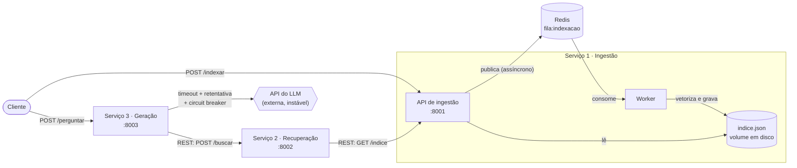

# RAG Distribuído em Microsserviços — C2.A2

**Sistemas Distribuídos e Computação em Nuvem · FAESA · 2026/2**

Sistema de perguntas e respostas sobre documentos (RAG), decomposto em **três
microsserviços independentes** que se comunicam por **REST** e por **fila (Redis)**,
com a chamada ao LLM protegida por **circuit breaker, tempo-limite e retentativa**.

> A sofisticação do modelo de IA não é o objetivo: o foco é a engenharia distribuída.
> O sistema funciona 100% offline (embeddings TF-IDF locais + LLM em modo simulado).

## Equipe

| Integrante | Responsabilidade |
|---|---|
| Carine | Serviço de **ingestão**: API e persistência do índice em disco |
| Gustavo | Serviço de **recuperação**: busca por similaridade |
| Lucas | **Mensageria**: fila de indexação (produtor) e worker (consumidor) |
| Juan | Serviço de **geração**: circuit breaker, retentativa, timeout; testes |
| Victor | **Infraestrutura**: Dockerfiles, docker-compose e documentação |

## Arquitetura



### Fluxo de indexação (assíncrono, via fila)

1. O cliente envia documentos para `POST /indexar` (ingestão).
2. A API **publica a mensagem na fila** do Redis e responde `202 Accepted` na hora.
3. O **worker** consome a fila, vetoriza (TF-IDF) e grava o índice em `indice.json`.
4. Se o Redis estiver fora do ar, a API **degrada**: indexa direto, de forma síncrona (`200`).

### Fluxo de pergunta (síncrono, via REST)

1. O cliente envia a pergunta para `POST /perguntar` (geração).
2. A geração chama a recuperação (`POST /buscar`), que lê o índice da ingestão (`GET /indice`),
   vetoriza a pergunta e devolve os `top_k` trechos mais parecidos (similaridade do cosseno).
3. A geração monta o prompt com os trechos e chama o LLM, **protegido** (ver abaixo).
4. A resposta volta com o **texto**, o **contexto** usado e as **fontes** (documentos de origem).

## Serviços e endpoints

| Serviço | Porta | Endpoint | Descrição |
|---|---|---|---|
| Ingestão | 8001 | `POST /indexar` | Recebe `[{"texto","origem"}]`, publica na fila (`202`) |
| | | `GET /indice` | Devolve o índice com os vetores (usado pela recuperação) |
| | | `GET /saude` | Status, nº de documentos e estado da fila |
| Recuperação | 8002 | `POST /buscar` | `{"pergunta","top_k"}` → trechos com `origem` e `score` |
| | | `GET /saude` | Status |
| Geração | 8003 | `POST /perguntar` | `{"pergunta"}` → `resposta`, `contexto`, `fontes` |
| | | `GET /saude` | Status e estado do disjuntor |

## Resiliência na chamada ao LLM

| Mecanismo | Onde | Configuração |
|---|---|---|
| **Tempo-limite** | cada tentativa expira | `LLM_TIMEOUT` (padrão 20s no código; 10s no compose) |
| **Retentativa** com backoff exponencial | `servicos/geracao/resiliencia.py` | `LLM_TENTATIVAS` (3) — só para erros passageiros (timeout, conexão, HTTP 429/5xx) |
| **Circuit breaker** | `servicos/comum/circuit_breaker.py` | `DISJUNTOR_LIMITE` (3 falhas), `DISJUNTOR_ESPERA` (20s) |

A retentativa fica **dentro** do disjuntor: uma pergunta que esgotou todas as tentativas conta
como **uma** falha para o circuito. Depois de 3 perguntas falhas o circuito **abre** e as
seguintes recebem `503` **imediatamente** (com `Retry-After`), sem esperar timeout. Passado o
tempo de espera, o circuito fica *meio-aberto* e deixa passar uma chamada de teste.

**Degradação elegante:** quando o LLM falha (`502`) ou o circuito está aberto (`503`), o corpo
da resposta ainda traz o `contexto` e as `fontes` recuperados. Se a recuperação cair, a geração
responde `503` com mensagem clara. Se não houver trecho relevante, responde que não encontrou
a informação, **sem gastar chamada ao LLM**.

Outras proteções: mensagens inválidas da fila vão para uma *dead-letter* (`fila:indexacao:erros`)
sem travar o worker; mensagens pegas e não concluídas voltam à fila se o worker reiniciar
(entrega *pelo menos uma vez*, com indexação idempotente); o worker reconecta sozinho ao Redis.

## Como executar (do zero)

**Requisitos:** Docker e Docker Compose. Não precisa de internet, GPU nem chave de API.

```bash
# 1. clonar e entrar na pasta
git clone https://github.com/juancunhaoliveira93-cloud/sd-2026-2-kit-c2a2.git
cd sd-2026-2-kit-c2a2

# 2. configuração (LLM_API_KEY vazia = modo simulado, offline)
cp .env.example .env

# 3. subir tudo: redis, ingestão, worker, recuperação e geração
docker compose up --build

# 4. (em outro terminal) indexar os documentos de teste
pip install requests                       # só para o script abaixo
python scripts/indexar_documentos.py

# 5. perguntar
curl -X POST http://localhost:8003/perguntar \
  -H "Content-Type: application/json" \
  -d '{"pergunta":"o que diz o teorema CAP?"}'

# 6. teste automatizado de ponta a ponta
python scripts/teste_e2e.py
```

Para usar um LLM real, preencha `LLM_API_KEY` (e, se precisar, `LLM_API_URL` / `LLM_MODELO`)
no `.env`. **A chave nunca vai no código nem no repositório** (`.env` está no `.gitignore`).

### Sem Docker (desenvolvimento)

```bash
python -m venv .venv && source .venv/bin/activate     # Windows: .venv\Scripts\activate
pip install -r requirements.txt
# precisa de um Redis em localhost:6379 (ex.: docker run -p 6379:6379 redis:7-alpine)

uvicorn servicos.ingestao.app:app    --port 8001
python -m servicos.ingestao.worker
uvicorn servicos.recuperacao.app:app --port 8002
uvicorn servicos.geracao.app:app     --port 8003
```

> Sem Docker o `.env` **não** é lido automaticamente: use `export LLM_API_KEY=...` no terminal.

## Testes

```bash
python -m unittest tests.test_geracao -v   # retentativa e circuit breaker (sem rede)
python scripts/teste_e2e.py                # fluxo completo (sistema rodando)
```

### Provocando falhas de propósito

```bash
# Redis cai -> /indexar passa a indexar de forma síncrona (200), sem quebrar
docker compose stop redis

# Recuperação cai -> /perguntar responde 503 com mensagem clara
docker compose stop recuperacao

# LLM inalcançável (equivale a desligar a internet): 502, 502, 502 e depois 503 imediato
LLM_API_KEY=x LLM_API_URL=http://127.0.0.1:9 docker compose up -d --force-recreate geracao
for i in 1 2 3 4 5; do
  curl -s -o /dev/null -w "%{http_code}\n" -X POST localhost:8003/perguntar \
    -H "Content-Type: application/json" -d '{"pergunta":"o que e falha parcial?"}'
done
curl localhost:8003/saude        # {"status":"ok","disjuntor":"aberto"}
```

## Estrutura do repositório

```
├── servicos/
│   ├── comum/            # embeddings.py, llm.py, circuit_breaker.py (do kit)
│   ├── ingestao/         # app.py, armazenamento.py, fila.py, worker.py, Dockerfile
│   ├── recuperacao/      # app.py, Dockerfile
│   └── geracao/          # app.py, resiliencia.py, Dockerfile
├── documentos/           # base de teste
├── scripts/              # indexar_documentos.py, teste_e2e.py
├── tests/                # test_geracao.py
├── docker-compose.yml
├── .env.example
└── README.md
```

## Decisões de projeto

- **Fila na ingestão:** indexar é lento e não precisa de resposta imediata; desacoplar via fila
  absorve picos e isola a API de falhas do worker.
- **REST entre recuperação e geração:** a pergunta precisa da resposta na hora (fluxo síncrono).
- **Índice em arquivo JSON com gravação atômica:** simples, persistente e compartilhado entre API
  e worker por um volume. Um banco vetorial seria o próximo passo para volumes grandes.
- **Recuperação reajusta o TF-IDF** sobre os mesmos textos do índice: o TF-IDF é determinístico,
  então a pergunta cai no mesmo espaço vetorial dos documentos. O vetorizador é cacheado.

## Extensões implementadas e limitações

- ✅ Citação das fontes (`fontes` na resposta) · ✅ Índice persistido em disco
- ⚠️ TF-IDF não tem lista de *stop words*: perguntas sem relação com os documentos que
  compartilhem palavras comuns ("de", "e") ainda podem recuperar trechos de baixa similaridade.
  O limiar é ajustável em `SCORE_MINIMO`.
- ⚠️ Um único worker é suportado (a recuperação de mensagens pendentes assume isso).

---
*Kit de partida: [howardroatti/sd-2026-2-kit-c2a2](https://github.com/howardroatti/sd-2026-2-kit-c2a2).*
